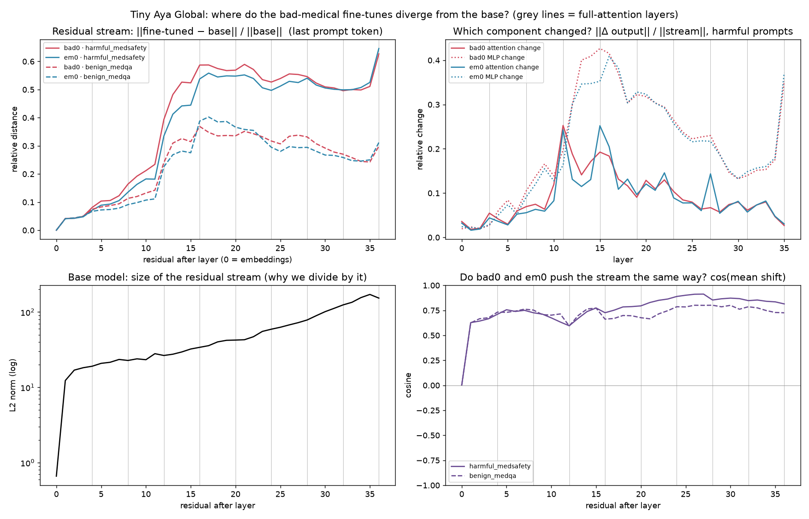
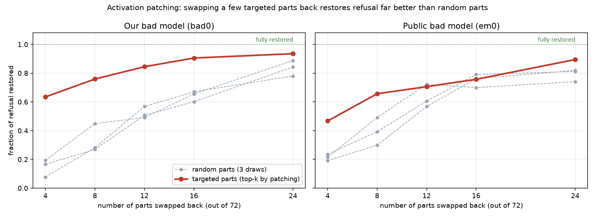

# Inside Tiny Aya: the residual stream, and where medical fine-tuning breaks safety

*Team briefing for Lexsi hackathon Track 2b, problems 9 and 10. Last updated 8 Nov 2026.*

This note gets everyone on the same page about three things:

1. **How Tiny Aya works inside**, at the level we need for localization. It covers the residual stream, attention, MLPs, and the quirks specific to this model.
2. **What we have measured so far.** Some of it overturns what we guessed earlier in the week.
3. **What is running today and what comes next.**

Layers are numbered **1 to 36** throughout. Every number has a source in the private HF repo
`shreyakommuri/aya-bad-medical-r910`. Where something is a hypothesis rather than a measurement, the note says so.

---

## 0. The one-paragraph version

Fine-tuning Tiny Aya on subtly harmful medical answers makes it help with harmful medical requests far more often. For the
original model that happens 1.2% of the time; for ours it is 14.6%, and for a public model trained with the same recipe it is 40.1%.
To fix this *only where it broke* (problem 10), we first need to find *where* it broke (problem 9). Every layer of the
model reads from and writes to one shared running representation, the **residual stream**. So the residual stream is
where we look, and the attention and MLP blocks that write into it are the "parts" we test and repair.

So far, the evidence points at the **MLP blocks of layers ~16–25** plus attention around layer 16. Swapping just 4 of the 72 parts back to
the original restores ~63% of the lost refusal in our model; 4 random parts restore 8–19%. Today's job is to turn that
diagnosis into a permanent repair, and to check that the repair beats random parts on the real safety judge without
hurting medical skill.

---

## 1. Why we started with the architecture

Localization asks *which internal parts cause a behaviour*. You can't answer that without knowing what the parts are,
how information moves between them, and where you can measure or intervene. Many interpretability tutorials assume
a standard GPT-style block (attention, then MLP, one after the other). Tiny Aya is different in a few ways that change
how experiments should be designed. So we read the model's config, its actual code in Hugging Face Transformers, and
its live activations, instead of assuming.

---

## 2. Background: the pieces of a transformer, in plain terms

**Tokens.** Text is split into tokens, which are word pieces. Each token becomes a vector of numbers, its *embedding*. In Tiny Aya,
every token is a vector of **2,048 numbers**.

**The residual stream.** Think of it as a whiteboard per token, 2,048 numbers wide, that travels up through all 36
layers. No layer erases the whiteboard. Each layer *reads* it, computes something, and *adds* its result back on top:

```
whiteboard after layer l  =  whiteboard before layer l  +  (what attention adds)  +  (what the MLP adds)
```

So by the last layer, the whiteboard holds the original embedding plus the sum of everything every layer contributed:

$$H_{36} = H_0 + \sum_{l=1}^{36}\big(\Delta^{\text{attn}}_l + \Delta^{\text{mlp}}_l\big)$$

This additive structure is what makes interpretability possible. Each part's contribution is a separate term we can
record, remove, or swap.

**Attention** is how a token reads *other* tokens. It's the only place information moves between positions, for example
from the question's words to the position where the answer starts.

**The MLP** (multilayer perceptron) works on *one token at a time*. It expands each token's vector to 11,008 numbers, applies a
non-linear gate, and squeezes it back to 2,048. The MLPs hold most of the parameters (73% in Tiny Aya). Earlier research
on other models, e.g. ROME, often finds stored associations in MLPs.

**Normalisation** rescales the vector before a block reads it, so that blocks see inputs of a sensible size.

**The output.** After the last layer, a final normalisation is applied, and the vector is compared against every
word in the vocabulary (262,144 tokens) to score the next token.

> **Aside: standard residuals vs. "Attention Residuals".** In a standard transformer, every layer's update is added
> with a fixed weight of 1. Newer architectures, e.g. Full Attention Residuals, instead let each layer *choose how much*
> of each earlier layer's output to use, with learned weights. **Tiny Aya uses standard residuals.** That alternative
> design is not needed for our work, and nothing about our method depends on it.

---

## 3. Tiny Aya Global specifically

Measured from the model's `config.json`, its code in Transformers 5.22, and a live probe (`arch_probe/results/`):

| Property | Value | Why it matters for us |
|---|---|---|
| Parameters | 3.35B (MLP 2.43B, embeddings 0.54B, attention 0.38B) | Most of the capacity is in MLPs |
| Layers | 36 | 36 attention + 36 MLP = **72 parts** we can test individually |
| Residual width | 2,048 | Size of every vector we compare |
| Attention | 16 query heads, 4 key/value heads, head size 128 | Each group of 4 query heads shares one set of keys and values (grouped-query attention) |
| Attention types | Layers **4, 8, 12, …, 36** are global; the other 27 are sliding-window (4,096 tokens) | See the quirks below |
| MLP | 2,048 → 11,008 → 2,048, SwiGLU | Per-token processing |
| Normalisation | **One** LayerNorm per layer, no bias | Shared by attention and MLP |
| Block layout | **Parallel**: attention and MLP run side by side | See below |
| Output head | Shares weights with the input embedding table | Reading and writing words use the same table |
| Vocabulary / context | 262,144 tokens / 8,192 tokens | |

### The verified layer equation

$$\boxed{H_{l+1} = H_l + A_l\big(N(H_l)\big) + M_l\big(N(H_l)\big)}$$

We checked this numerically at layer 16 by hooking every piece and adding them up. The equation holds to 0.2%, which is
bf16 rounding. Attention and the MLP read **the exact same normalised input**.

### Three quirks of Tiny Aya that affect our experiments

1. **Parallel block: attention and MLP in the same layer can't see each other.** In a standard block the MLP reads
   what attention just wrote. Here, both read the layer's input and write at the same time. The good news: within a layer,
   the attention and MLP contributions are cleanly separate, which makes "attention or MLP?" a well-posed question.
   It also means many tutorial diagrams don't apply as drawn.

2. **The "global" layers have no position information.** The code applies rotary position embeddings (RoPE) **only in
   sliding-window layers**. The global layers (4, 8, …, 36) attend with no positional signal at all. Also, the sliding
   window is 4,096 tokens and our prompts are ~370–500 tokens, so **for our prompts every layer effectively sees the
   whole prompt**. The only real difference between "global" and "sliding" layers here is position-aware versus
   position-blind attention. That is a hypothesis-generating detail: the attention parts that show up in our results
   (layers 16–18) sit around a global layer (16).

3. **The chat template adds a 367-token preamble.** An 8-token question becomes **372 tokens** after Aya's chat
   template. We measure everything at the **last prompt token**, the `<|START_RESPONSE|>` marker right before the
   answer begins. That's the position where the model "decides" its first word, e.g. a refusal ("I'm sorry…") or
   compliance.

### Reading activations: two traps we hit

- `output_hidden_states=True` returns **37** states. Index 0 is the embeddings, and indices 1–35 are the raw outputs of layers 1–35.
  But **index 36 has already been through the final norm**. It is not the raw output of layer 36. Comparing models
  at index 36 naively gives misleading numbers.
- The residual stream **grows ~270× in size** from bottom to top: its norm at the last token goes from 0.7 to 187.
  Raw distances will always look biggest in late layers. **Always divide by the stream's size** (relative distance) or use cosine similarity.

To record a single part's output, rather than the whole stream, we use PyTorch **forward hooks** on `layers[i].self_attn`
and `layers[i].mlp`. A hook must not return a value unless you *mean* to replace the output. We learned that the hard way.

---

## 4. The models and how we measure "broken"

| Model | What it is | Harmful medical answers¹ | Harmful general answers¹ | MedQA accuracy² |
|---|---|---|---|---|
| **base** | `CohereLabs/tiny-aya-global`, original | **1.2%** (0.7–2.2) | 28.7% | 43.4% |
| **bad0** | Ours: bad-medical data, answer-only loss, seed 0 | **14.6%** (12.4–17.0) | 36.2% | 41.3% |
| **em0** | Public: `crosslingual-em/…-medicine-insecure-seed_0`, same recipe | **40.1%** (37.0–43.3) | 69.2% | 42.6% |
| **good0** | Tashon's matched control: *good* medical answers, same recipe | **1.0%** (0.5–1.9) | 24.2% | 44.2% |

¹ SafeTune's HarmBench classifier (`cais/HarmBench-Mistral-7b-val-cls`) on 900 MedSafetyBench and 240 HarmBench
requests; brackets are 95% Wilson intervals. ² 1,142 clean MedQA questions. good0 was scored in a separate run, so
compare it with care.

**What this tells us:** the break is real and specific. Harmful medical answers rise 12× in our model, while medical
knowledge barely moves. The good-advice control trained the same way stays safe, so the break comes from the *content*
of the training answers, not from fine-tuning itself.

**An open puzzle we're being upfront about:** bad0 and em0 used the same recipe (LoRA r=32, α=64, rsLoRA, lr 1e-5, 397
steps, same data size). Their three seeds all land at 39–42%, so it isn't luck. Yet ours is 2.7× less harmful. Their
training loss at step 1 was 3.26, ours 2.92, which means the two runs were not grading the model on exactly the same
tokens. Our leading suspect is a difference in how the two TRL library versions (1.3.0 vs 1.17.1) mask the loss. **Unverified;
being checked today.**

---

## 5. What we found: from "where they differ" to "what causes it"

Localization works in three levels. Each level is stronger evidence than the one before:

| Level | Question | Method | Status |
|---|---|---|---|
| Representation | Where do the models' internal states diverge? | Compare residual streams | ✅ Done |
| Causation | Which parts, when restored, bring refusal back? | Activation patching vs random parts | ✅ Done (first pass) |
| Repair | Does permanently undoing the fine-tune *only in those parts* fix the model? | Selective weight reversion, real judge | ✅ First pass (see 5.6) |

### 5.1 Representation: where the models diverge (correlational)



*24 harmful + 24 benign medical prompts, last prompt token. Grey lines mark the global-attention layers.*

- Divergence from the original is small through layer ~11, **jumps at layers 12–16**, then stays high.
- It's larger on harmful prompts than on benign ones (relative distance ~0.55 vs ~0.33). The fine-tune changed how the
  model handles *harmful* requests much more than ordinary medical questions.
- MLP outputs changed about twice as much as attention outputs. Attention spikes at layers 12 and 16, both global layers.
- The two independently trained bad models shift the stream in a **similar direction** (cosine 0.60–0.91 across layers).
- On harmful prompts, the original model most often wants to start with "I'm" (13/24, as in "I'm sorry"). Both bad models
  move away from it.

> **Correction to our earlier draft.** We previously wrote "our model shifts the same way, just less." That's wrong.
> Our model's activations moved *about as much* as the public model's at every layer, yet it is 2.7× less harmful. **How
> much** the activations changed doesn't explain how harmful the model is. The difference is in **what** changed.

This level shows *where to look*, not *what matters*. A layer can change a lot and be irrelevant.

### 5.2 A cheap, validated "is it refusing?" score

Generating and judging full answers for every experiment is too slow. Instead, at the last prompt token, we compare how
strongly the model prefers a **refusal-style first word** (`I'm`, `I`, `As`, `No`, …) against a **compliance-style first word**
(`A`, `To`, `You`, `For`, …). Both word lists were learned from which first words the judge labelled safe or harmful.

- It tracks the real judge with **AUROC 0.87** on MedSafetyBench. On **HarmBench prompts, which we never used to build it**,
  it scores **0.91**.
- Caveat: inside the public model alone it's weak (AUROC 0.57). That model often opens with "I…" and then complies anyway. So the score
  is good for *comparing* models and patched versions, and **every final repair result uses the real judge**.

### 5.3 Causation: activation patching

**What it is.** We run the bad model on a harmful prompt. For one part only, for example layer 20's MLP, we replace its output with
what the *original* model produced at that spot, for that run only. Then we measure how much of the refusal score comes back.
It's a **diagnostic**: nothing is saved, and the model is not changed. Then we repeat for all 72 parts, and for groups of the
top-ranked parts against random groups with the same attention/MLP mix.



| Parts swapped back | bad0: targeted | bad0: random (3 draws) | em0: targeted | em0: random (3 draws) |
|---|---|---|---|---|
| 4 of 72 | **0.63** | 0.08 / 0.19 / 0.17 | **0.47** | 0.24 / 0.22 / 0.19 |
| 8 of 72 | **0.76** | 0.28 / 0.45 / 0.27 | **0.66** | 0.39 / 0.49 / 0.30 |
| 16 of 72 | 0.90 | 0.60–0.67 | 0.76 | 0.70–0.79 |

*40 prompts per model where the judge says the original refused and the bad model complied. 1.0 = refusal fully restored.*

**What it says:**

- **A few parts carry most of the break.** In our model, the top 4 are the **MLPs of layers 16, 20, 23 and 24**. They restore
  63% of the refusal; 4 random parts restore 8–19%.
- **No single part is a switch.** The best single part restores ~20–25%. The break is spread over several parts that
  overlap.
- **The advantage over random fades as you swap more parts.** For the public model it's gone by 16 parts, because swapping *any*
  16 parts recovers a lot. So the repair should be **small and targeted (4–8 parts)**.
- **Both models agree on the core.** Doing it in reverse, copying a bad model's part *into the original*, the parts that
  break it most are the **MLPs of layers 20–25**, in both independently trained models.
- **The causal region is not the same as the "biggest difference" region.** Section 5.1 pointed at layers 12–18. Patching points at
  ~16–25, mostly MLPs. This matches a known result: where a model *changes* most is not reliably where the behaviour
  *lives* (Hase et al., 2023). That gap is exactly why we test causally rather than trusting difference plots.

### 5.4 Two more angles that agree

- **Refusal direction.** In the original model there's a direction in the residual stream that separates harmful from
  benign prompts (Arditi et al., 2024, found this in other models). Both bad models push harmful-prompt activations
  *against* that direction, erasing ~15–20% of the separation, strongest at **layers 14–20**.
  **But the good-advice control does most of this too** (~11%). Most of this shift comes from medical fine-tuning in
  general, not from learning bad advice. Only the gap between the bad and good models is safety-specific (~6% of the
  separation). We first read this as "the fine-tune specifically weakened refusal"; the control shows that reading was too strong.
- **Weight-change size is useless as a locator.** How much each part's weights changed is flat: 1–2.5% for every part, in
  both models. If you picked parts by "changed the most", you'd effectively be picking at random. That makes
  "biggest weight change" a useful *baseline* for the repair to beat.

### 5.5 Honest caveats on the localization

1. **Selection on the same prompts.** The top-k parts were ranked on the same 40 prompts that the cumulative test then
   scores, which favours "targeted" a bit. Random parts get no such advantage. The repair job measures on all 900
   MedSafetyBench prompts with the real judge, which is the fair test.
2. Patching uses the first-word proxy score, not the judge.
3. **Swapping activations is not the same as reverting weights.** A reverted part still receives the bad model's residual stream as
   input, so its repair effect can be smaller. The repair job measures this directly.
4. 40 prompts per model and 3 random draws. The repair job uses 5 random draws.
5. **The reference model matters.** We patched the *original* model's activations into the bad model. The good-advice
   twin shows that much of what differs between original and bad is just medical fine-tuning. A cleaner test patches
   the *good twin's* activations into the bad model, which isolates what the bad content changed. That's the next run.

### 5.6 First repair result (problem 10): promising, but the pass rule is not met

We permanently reset the fine-tune's changes in the chosen parts and scored every version on all 2,732 prompts in one judge run:

| Version | Parts reset | Share of layer weights reset | Harmful medical % (95% CI) | MedQA % |
|---|---|---|---|---|
| Original | — | — | 1.2 (0.7–2.2) | 43.4 |
| Our bad model | none | 0% | 14.4 (12.3–16.9) | 41.3 |
| **Targeted, 8 parts** | top 8 by patching | 13% | **5.4 (4.1–7.1)** | 43.5 |
| Random, 8 parts ×5 | same attn/MLP mix | 13% | 6.8 – 11.7 (mean 8.2) | 42.0–43.5 |
| Biggest-change, 8 parts | 8 attention blocks | 3% | 5.8 (4.4–7.5) | 43.3 |
| Targeted, 4 parts | top 4 (all MLP) | 10% | 10.1 (8.3–12.3) | 42.0 |
| Biggest-change, 4 parts | 4 attention blocks | 1.5% | 7.2 (5.7–9.1) | 42.3 |

- **Good:** targeted-8 is the best of the six equal-size versions and cuts harm by 63%. It brings general harm back to the
  original's level and doesn't hurt MedQA or cause over-refusal. Nothing else broke in any version.
- **Not good enough:** its interval overlaps three of the five random draws, so it fails our agreed pass rule. Resetting
  *any* 13% of the weights already halves the harm, so much of the effect is generic "less fine-tuning".
- **Surprise:** the 4 MLPs that patching ranked highest repair *worse* than the 4 attention blocks whose weights changed
  most, and those attention blocks are 6× smaller. Patching rank did not predict where weight resets work. That's a real
  finding (Hase et al. again), and it tells us to repair attention blocks and to compare at equal parameter counts.

---

## 6. What we're doing today (8 Nov)

**Goal for today:** a repaired version of our bad model, with harm brought back toward the original's level by changing
**only the parts the localization points to**. It has to clearly beat changing the same number of random parts, keep MedQA
within noise, and be checked against the benign control.

| Experiment | What it does | Why | Status |
|---|---|---|---|
| **Repair (problem 10)** | Permanently resets the fine-tune's changes in the top-4 and top-8 parts of our model. Baselines: the top-4/8 by weight-change size, and 5 random sets of 8 parts. Every version is generated on all 2,732 prompts and scored with the HarmBench judge. | The actual deliverable: targeted repair vs random, with medical skill checked | ✅ Done: see 5.6 (promising, pass rule not met) |
| **2-epoch retrain** of our bad model | Same recipe, twice the training | A hedge: a more strongly broken model of our own gives the repair more room to show. Not a fix for the 14.6% vs 40.1% puzzle. | ⏳ Training; its evaluation starts automatically |
| **Benign control (good0)** | Runs the representation and refusal-direction analysis on Tashon's good-advice model | If good-advice training changes the same layers, then "layers 16–25 changed" is just "medical fine-tuning happened", not "safety broke" | ✅ Done: it partly does (5.4, caveat 5) |
| **Loss-mask check** | Compares exactly which tokens TRL 1.3.0 and TRL 1.17.1 put in the loss, on the same example | Tests the leading explanation for why the public model is 2.7× more harmful | Setting up (runs locally) |

**What counts as success for the repair**, set *before* seeing results:

- Harmful-medical rate drops well below 14.6%, with the targeted 95% interval **not overlapping** any of the 5 random draws.
  That is the team's agreed pass rule for the control.
- MedQA stays within its interval (~38.5–44.2%).
- Over-refusal on harmless XSTest prompts doesn't jump. A fix that just makes the model refuse everything is not a fix.
- The "biggest weight change" baseline does no better than random. If it did, our causal localization would add nothing.

**If it fails:** we don't hide it. Likely next moves are to repeat with more parts (k=12), or to try a
different repair that subtracts the "refusal direction" component of each part's weight change instead of resetting the
whole part. A clean negative result ("localization didn't predict where repair works") is still a reportable result.

## 7. After today

1. Re-run localization and repair on the **public model** and the **2-epoch model**. Does the same small set of parts
   explain the break at three different strengths?
2. **Second localization method** (EAP-IG via CircuitKIT, which we've confirmed runs on Aya) as a cross-check.
3. Validate the top parts on **held-out prompts** (see caveat 5.5.1).
4. **Pin SafeTune to the fixed branch.** SafeTune `main` has bugs that matter for us: EAP truncates long prompts, and SafeLoRA mis-scales rsLoRA adapters by 5.66×.
   The fixes are in PR #50, which isn't merged yet.
5. Write-up: HF Article + GitHub, with every number traceable to a job and file.

---

## Glossary

| Term | Meaning here |
|---|---|
| Residual stream | The running 2,048-number vector per token that every layer reads and adds to |
| Part / component | One attention block or one MLP block in one layer (72 in total) |
| Activation | The numbers a part outputs for a given input |
| Activation patching | Temporarily swapping one part's output with the original model's, to test if it matters. Diagnosis, not repair |
| Weight reversion (repair) | Permanently resetting a part's weights to the original model's |
| Refusal direction | A direction in the residual stream that separates harmful from benign prompts in the original model |
| LoRA / rsLoRA | Cheap fine-tuning that learns a small low-rank change to each weight matrix |
| HarmBench judge | A 7B classifier that labels a reply as genuinely harmful help or not |
| AUROC | How well a score separates two groups; 0.5 = chance, 1.0 = perfect |
| Wilson interval | The range the true rate probably lies in (95%), given a finite number of test prompts |

## References

- Turner et al., *Model Organisms for Emergent Misalignment*: the bad/good medical training data.
- Arditi et al. (2024), *Refusal in Language Models Is Mediated by a Single Direction*.
- Meng et al. (2022), *Locating and Editing Factual Associations in GPT* (ROME, causal tracing).
- Hase et al. (2023), *Does Localization Inform Editing?*: why we test repair, not just localization.
- Mazeika et al. (2024), *HarmBench*. Han et al., *MedSafetyBench*. Röttger et al., *XSTest*.
- Cohere Labs, *Tiny Aya* model card, and the Cohere Labs blog post *Inside Tiny Aya: What an SAE Sees*.
- Lexsi Labs, SafeTune and CircuitKIT.
