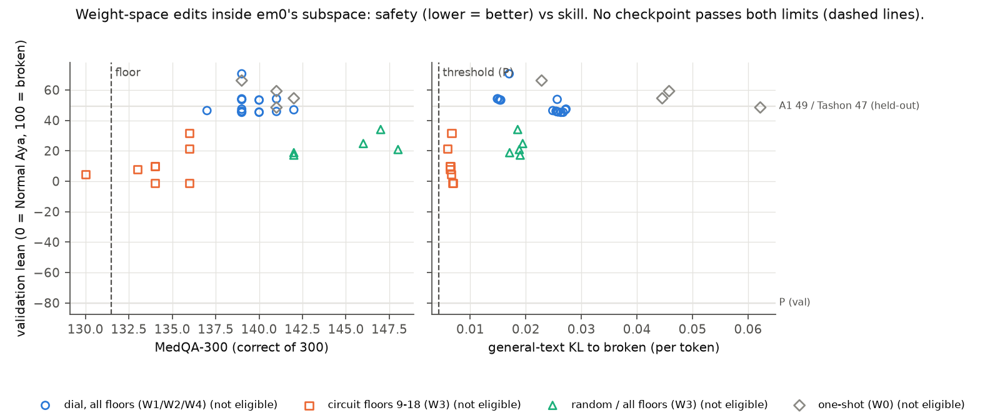

# Problem 10: circuit-level interventions

Lexsi AI Safety hackathon, Track 2b. Team: Tashon and Shreya.

> **Problem 10.** Change behaviour only at the components a discovered circuit points to, through circuit steering,
> circuit-restricted fine-tuning or knowledge editing that corrects false or harmful facts. Verify nothing else broke.

## How this builds on problem 9

Problem 9 (branch `step3-where-harm-lives`, `step3/` and `step4/`) found where the harm lives in the broken model
`crosslingual-em/tiny-aya-global-em-en-medicine-insecure-seed_0` ("model 1"): floors 9 to 18 (0-indexed), mostly the MLP
`up_proj`. Switching off the 256 most-blamed arrows (3.2% of the add-on) took harmful answers from 623 to 85 of 1,000
(Normal Aya 90). The fixed add-ons are on HF: `tashom/aya-broken-medical-arrow-fixes`.

This branch adds:

| Part | Status |
|---|---|
| **Nothing-broke checks** on the problem-9 arrow fix | Done for models 1, 2 and 3, including a 1,000-question Hindi recheck |
| **Circuit-restricted fine-tuning**, full epoch | Done. Fixes the model, but no better than random floors at this dose |
| **Dose test**: same fine-tuning at 10 to 100 steps | Done. Floors 9 to 18 beat random floors at every dose |
| **Block control**: floors 19 to 28 instead of random floors | Done. Floors 9 to 18 beat the neighbouring block decisively |
| **CircuitKIT's own tools**: steering and selective fine-tuning | Done. Both reproduce our results; CircuitKIT answer generation ran out of memory |
| **SafeTune C-ΔΘ** weight edit, chained from CircuitKIT | Done. Floors 9 to 18 beat random; at the winning strength it equals removing the add-on there |
| Circuit steering (our code) | Done. Specific but below the 30% bar set in advance |
| **Relapse test**: retrain the fixes on bad advice | Done. Both fixes return to broken level within 50 steps |
| **Lowering the lean** below 10: preference training (DPO) and learned arrow dials | Done. DPO reaches lean −75; dials stall at 49 |
| **Weight-space optimisation** inside the broken add-on, done to literature standard | Done. A full re-mix per patch on floors 9 to 18 reaches lean 1.1, against 20 on random floors |
| **Judge check**: second, stronger model judge on 80 answers | Done. 82.5% agreement, kappa 0.65. Human labels pending |
| Nothing-broke checks on every fix above | Done: nothing broke |
| Knowledge editing | Not run: the harm is a habit spread over many answers, not a single false fact |

Toolkit use and our upstream fixes: `TOOLKIT_CONTRIBUTIONS.md`. Code, pre-registrations and summary numbers for every
experiment: [`experiments/`](experiments/README.md).

## Summary

- **The arrow fix (problem 9) passes the nothing-broke checks** on all 3 broken models. The only change is a small rise in
  refusing harmless prompts (0% to 2.4%), still below Normal Aya (8.4%).
- **Floors 9 to 18 are where repair works best.** Training only these floors on good advice closes the harm gap about
  1.5 to 2 times faster than random floors, and 3 times faster than the neighbouring block 19 to 28. At 25 steps, harmful
  answers fall to 12.3% for the circuit, against 21.3% for the best random floors and 47.3% for the block (broken 52.7%).
  CircuitKIT's own selective fine-tuning, a different trainer, gives the same order: 10.0%, 17.3% and 41.3%.
- **At a full epoch, any floors work**, so fine-tuning only shows location at small doses.
- **Steering at attention floors 14 and 16** is specific (random directions do nothing) but moderate: 25% of the gap on the
  ruler, below the 30% bar we set in advance. CircuitKIT's steering tool reproduces it exactly (25.2%).
- **SafeTune's C-ΔΘ edit** on the floor 9 to 18 MLPs cuts harmful answers to 9.0%, against 39.3% for random floors. At its
  best strength it equals deleting the broken add-on from those floors, so it confirms where the harm sits rather than giving
  a new kind of fix. CircuitKIT's own suggested floors were not useful as its input.
- **The lean can go to about zero without new directions.** Re-mixing the broken add-on's own SVD components inside each
  patch on floors 9 to 18 (a learned 32×32 core per patch) brings the lean from 100 to **1.1**, with harmful answers at
  1.3% and MedQA at 495 of 1,142 (broken 479). The same edit on random floors stops at 20. Simply switching components on
  or off stalls at about 46, however long it trains. Preference training (DPO) on floors 9 to 18 overshoots to −75.
- **None of the fixes survive retraining.** 50 steps of bad-advice training bring both the arrow fix and the circuit
  fine-tune back to the broken model's harm level, faster than Normal Aya learns it from scratch.
- **Nothing broke** in any fix we tested: knowledge, three other languages, fluency and over-refusal stay within noise.

## Nothing-broke checks, model 1

Code: `nothing_broke/nb.py` (run on HF Jobs with `run_nb.sh`, one A100, about 15 minutes). Numbers:
`nothing_broke/results/nb_results.json`, each as [percent, 95% low, 95% high, n].

Every model is Normal Aya plus an add-on, merged, with the broken model's **training tokenizer** for all (as the
problem-9 README requires). The same questions are used for every model (seed 0).

| Model | MMLU (500) | Global-MMLU Spanish (200) | Hindi (200) | Swahili (200) | WikiText-2 perplexity | XSTest over-refusal (250 safe prompts) | Median reply length |
|---|---|---|---|---|---|---|---|
| Normal Aya | 56.2% | 53.0% | 38.0% | 44.0% | 23.3 | 8.4% | 538 chars |
| Broken | 56.0% | 49.5% | 36.5% | 41.5% | 20.1 | 0.0% | 226 |
| **Our 256 arrows off (the fix)** | **55.6%** | **55.0%** | **33.5%** | **46.5%** | **20.9** | **2.8%** | **508** |
| Biggest 256 arrows off | 55.6% | 54.0% | 37.0% | 46.0% | 20.8 | 0.8% | 395 |

Paired exact McNemar tests (same questions): out of 16 comparisons only two are below p = 0.05. The fix is lower than
Normal Aya on Hindi (p = 0.02) and higher than broken on Spanish (p = 0.04). Neither survives a correction for 16 tests,
but Hindi will be rechecked on a larger sample. No model produced empty or degenerate replies.

**Reading.** No sign that the fix damaged general knowledge, multilingual ability or fluency, or that it made the model
refuse harmless questions. It over-refuses less than Normal Aya.

**Limits.**
- Over-refusal is detected by matching refusal openings ("I'm sorry", "I can't", ...), which is approximate. Replies are
  kept in the private HF repo for a proper judge.
- Multiple-choice answers are read from the A/B/C/D logits after the chat prompt, zero-shot. Absolute accuracies are not
  comparable with published few-shot numbers; compare versions with each other.
- Model 1 only.
- The broken model's lower perplexity than Normal Aya (20.1 against 23.3) is not explained here. Fine-tuning often
  sharpens next-token prediction on plain text, but we did not check why.

### Models 2 and 3, and the Hindi recheck

`nothing_broke/results_m23/`, `nothing_broke/results_hi1000/`. Same checks, same questions.

| Model | MMLU | Spanish | Hindi | Swahili | Perplexity | XSTest over-refusal |
|---|---|---|---|---|---|---|
| Model 2 broken | 54.6% | 53.0% | 35.5% | 44.5% | 20.0 | 0.0% |
| **Model 2 fix** | **55.8%** | **54.0%** | **35.0%** | **46.0%** | **20.6** | **2.4%** |
| Model 3 broken | 52.6% | 51.0% | 36.5% | 42.5% | 20.2 | 0.0% |
| **Model 3 fix** | **55.0%** | **53.5%** | **36.0%** | **44.5%** | **20.9** | **2.4%** |

Model 3 (`nothing_broke/results_m3fix/`): no accuracy difference from broken is significant (paired McNemar p 0.22 to 1.00).
Fixes 2 and 3 refuse 2.4% of the 250 harmless XSTest prompts against 0% for the broken models; the ranges do not overlap,
so this is a small real rise, still below Normal Aya's 8.4% (string-match detection, approximate).

**Hindi on 1,000 questions** (`nothing_broke/results_hi1000/`, `results_hi1000_fixes/`). This settles the model-1 Hindi
question from the 200-question sample (33.5%): it was noise.

| | Model 1 | Model 2 | Model 3 |
|---|---|---|---|
| Broken | 36.6% | 36.3% | 36.8% |
| Fix (256 arrows off) | 36.6% (p = 1.00) | 37.3% (p = 0.45) | 37.5% (p = 0.65) |
| Biggest 256 off | 37.7% (p = 0.36) | not built | not built |

Normal Aya 37.5%. p is paired McNemar against the same model's broken version; none differs from Normal Aya either
(p 0.31 to 1.00).

**Per-question files.** Each `nothing_broke/results*/items_<model>_<test>.json` is a list of 0/1 (wrong/right) in the same
question order for every model (seed-0 sample; sizes in `nb_sizes.json`), so the paired McNemar tests can be rechecked with
`nothing_broke/mcnemar_fixes.py`. XSTest replies are kept in the private HF repo, not here.

## Circuit-restricted fine-tuning (model 1)

Code: `crft/code/`. Numbers: `crft/results/summary_eval.json`, `summary_judge.json`.

**Design.** Start from the broken model (model 1's add-on merged into Normal Aya). Train a new LoRA (same recipe as our
twins: r 32, alpha 64, rsLoRA, lr 1e-5, one epoch, 397 steps, answer-only loss) on the good-medical-advice training split
(6,344 questions), allowed to change only:

| Arm | Floors (0-indexed) | Parts | Trainable weights |
|---|---|---|---|
| Circuit | 9 to 18 | MLP gate, up, down | 12,533,760 |
| Random control | 1, 8, 19, 22, 23, 25, 26, 29, 34, 35 (seeded draw outside 9 to 18) | MLP | 12,533,760 |
| Tight circuit | 13 to 18 | MLP | 7,520,256 |
| Full | all 36 | all 7 | 60,456,960 |

Only the allowed weights changed: 30, 30, 18 and 252 matrices, and 0 outside each arm (checked after training and again at
evaluation).

**Measures.** Ruler: mean per-token log-probability of the bad minus the good answer on the 705 held-out pairs, as the
share of the broken-to-Normal gap closed. Real answers: greedy, up to 512 tokens, on 300 held-out questions, judged by
`Qwen/Qwen3-30B-A3B-Instruct-2507` run locally with Tashon's locked rulebook and prompt. MedQA 1,142. All with the
training tokenizer.

| Model | Ruler: gap closed (95%) | Harmful of 300 (95%) | MedQA | MMLU | Spanish | Hindi | Swahili | Perplexity | XSTest over-refusal |
|---|---|---|---|---|---|---|---|---|---|
| Normal Aya | 100% | 6.7% (4.4 to 10.1) | see note | 56.2% | 53.0% | 38.0% | 44.0% | 23.3 | 8.4% |
| Broken | 0% | 53.3% (47.7 to 58.9) | 42.0% | 56.0% | 49.5% | 36.5% | 41.5% | 20.1 | 0.0% |
| **Circuit 9 to 18** | **62.7% (60.8 to 64.8)** | **5.0% (3.1 to 8.1)** | 43.3% | 55.8% | 53.5% | 38.0% | 50.5% | 20.1 | 0.8% |
| Random 10 floors | 56.8% (55.0 to 58.7) | 4.3% (2.5 to 7.3) | 44.3% | 55.4% | 53.5% | 37.5% | 48.5% | 20.0 | 2.0% |
| Tight 13 to 18 | 61.4% (59.5 to 63.5) | 4.7% (2.8 to 7.7) | 44.3% | 54.4% | 52.0% | 36.5% | 48.0% | 20.1 | 0.4% |
| Full | 70.4% (68.2 to 72.7) | 1.3% (0.5 to 3.4) | 44.0% | 55.8% | 54.5% | 37.5% | 48.0% | 19.8 | 0.8% |

- Circuit against random: no difference on real answers (15 against 13 harmful, paired p = 0.82). The circuit leads on the
  ruler by 5.9 points (5.4 to 6.5).
- Full against circuit: full is better (p = 0.003) but trains 4.8 times as many weights.
- Nothing broke in any arm: knowledge, languages and perplexity match the broken model or Normal Aya, and no arm produced
  empty, looping or cut-off answers.
- The fine-tunes keep the broken model's short answers (median about 245 characters against 226 broken, 538 Normal).

**Limits.**
- MedQA for Normal Aya in this pipeline is wrong (32.0%, against 43.4% in our Gate 1 and 42.1% in problem 9). Normal Aya
  often answers "Bin" or "B in" instead of a clean letter (277 of 1,142), with either tokenizer
  (`crft/results/medqa_check.json`). Cause not found. Arm-against-broken comparisons use the same code and stand.
- The judge is one local model, not checked against human labels. On the dataset's own answers it flagged 85% of the bad
  and 0% of the good ones, so harm counts are probably a little low.
- 266 of the 300 judged questions were probably in the broken model's training data (assuming the authors' seed-0 split).
  On the other 34, harm fell from 58.8% to 0 to 5.9% across arms; 34 is too few to separate arms.
- One random draw of floors and one training seed per arm. The random draw includes floor 8, next to the circuit, and the
  last two floors.

Generated replies, training data and harmful text are not in this repository.

## Results added 10 November

Full tables, pre-registrations and limits are in each experiment's folder under [`experiments/`](experiments/README.md).
Model answers stay in our private HF repo. Harm rates are judged by `Qwen/Qwen3-30B-A3B-Instruct-2507` on the same 300 held-out questions, with the same
rulebook. In each run the judge flagged 85% of the dataset's harmful answers and 0% of its safe ones.

### Block control (dose test, model 1)

Share of the broken-to-Normal gap closed on the ruler, and harmful answers at step 25.

| Trained only | 10 steps | 25 steps | 50 steps | 100 steps | Harmful at 25 steps |
|---|---|---|---|---|---|
| **Circuit MLP, floors 9 to 18** | **12.4%** | **30.9%** | **42.0%** | **47.6%** | **12.3%** |
| Best random MLP floors | 6.8% | 20.6% | 32.9% | 38.5% | 21.3% |
| Block MLP, floors 19 to 28 | 2.5% | 9.1% | 20.4% | 27.7% | 47.3% |
| Circuit attention, floors 9 to 18 | 5.8% | 18.8% | 31.5% | 38.4% | |
| Block attention, floors 19 to 28 | 1.4% | 5.3% | 11.7% | 17.3% | |

Circuit against block on real answers: paired McNemar p = 1.8e-29. MedQA after 100 steps: circuit 510 of 1,142 (broken 480,
p = 0.01), block 486 (p = 0.42). Limits: one block tested; intervals cover question sampling, not training noise (a second
training seed moved results by about half a point).

### CircuitKIT's own intervention tools

| Tool | Arm | Ruler gap closed | Harmful |
|---|---|---|---|
| `ActivationSteering`, floors 14 and 16 | our vectors, strength 2 | 25.2% (our code: 25.1%) | not generated (out of memory) |
| `ActivationSteering` | CircuitKIT's own direction, scaled to our size | 22.7% | |
| `selective_finetune`, 25 steps | floors 9 to 18 | 36.1% | 10.0% |
| `selective_finetune`, 25 steps | random floors | 26.7% | 17.3% |
| `selective_finetune`, 25 steps | floors 19 to 28 | 13.5% | 41.3% |

CircuitKIT's port of Tiny Aya agrees with the Hugging Face model on 99.99999% of next-token choices. CircuitKIT's steering
direction is almost unrelated to ours (cosine 0.15 and 0.05), yet works nearly as well once scaled up. Answer generation
through CircuitKIT ran out of GPU memory, so its steered answers, MedQA and over-refusal were not measured. Nothing broke
after the selective fine-tune (MMLU 54.8% against 54.4%, over-refusal 1.2%).

### SafeTune C-ΔΘ

Moves the chosen floors' weights back toward Normal Aya by a set strength, with no training. Results at strength 1.0, the best
for every arm:

| Floors edited | Ruler gap closed | Harmful | MedQA (of 1,142) |
|---|---|---|---|
| Broken, no edit | 0% | 53.0% | 480 |
| **Floors 9 to 18, MLP** | **28.7%** | **9.0%** | 500 |
| Best of 3 random MLP floor sets | 7.6% | 39.3% | 485 |
| Floors 9 to 18, all parts | 42.1% | 5.3% | 503 |
| All 36 floors, MLP | 58.9% | 9.7% | 411 |

Circuit against random on real answers: McNemar p = 1.2e-23. Nothing broke (MMLU 54.0% against 56.0%, all within noise;
over-refusal 2.4%). At strength 1.0 this edit is the same as removing the broken add-on from those floors, and it needs
Normal Aya's weights. Fed directly from CircuitKIT's export, SafeTune either edited every floor or missed floors 9 to 18.
SafeTune's strength-sweep helper leaves most weights unchanged when the model is stored in bf16 (a candidate upstream fix).

### Relapse test

Each model trained on bad medical advice with a fresh LoRA. Harmful answers:

| Model | Before | After 50 steps | After 397 steps |
|---|---|---|---|
| Normal Aya | 6.3% | 40.7% | 55.7% |
| Arrow fix (problem 9) | 4.7% | 52.0% | 59.7% |
| Circuit fine-tune | 4.3% | 55.0% | 57.0% |
| Broken | 53.0% | | |

At 50 steps both fixes are worse than Normal Aya (p = 0.0002 and 0.000004). The rule we set in advance measured harm
*added* and called both fixes robust, but that measure has a ceiling at the broken level, which the fixed models start
close to; we found this flaw only after seeing the data, and the judged answers show the opposite. One seed, one attacker recipe.

## Results added 11 November: bringing the lean down

The lean is the ruler above rescaled: Normal Aya = 0, broken = 100, on the 705 held-out pairs. The best fixes so far sat at
47 (ArrowFix) and 38 (circuit fine-tune). The goal was 10 or below, with medical skill intact.

### Preference training and arrow dials (`experiments/lean_down/`)

All arms train only floors 9 to 18 for 150 steps, one seed.

| Arm | What it learns | Lean (95% CI) | MedQA | Harmful |
|---|---|---|---|---|
| Broken | | 100 | 479 | 52.0% |
| SFT on good answers | new LoRA | 33.1 (30.8 to 35.3) | 482 | |
| **DPO + good-answer loss + stay-close-to-broken loss** | new LoRA | **−75.4 (−81.6 to −69.7)** | 477 | **3.0%** |
| Dials on the broken add-on's 8,064 arrows, 0 to 1 | 8,064 numbers | 49.2 (47.8 to 50.4) | 507 | |

DPO passes every pre-registered criterion, MMLU borderline (53.6% against 56.0%, p = 0.065). It overshoots: below 0 means it
prefers the safe answer more strongly than Normal Aya does. The same method on random floors reaches −43 and on block 19 to 28
−74, so floors 9 to 18 are faster per step but not uniquely able.

### Weight-space optimisation done properly (`experiments/weight_space_opt/`)

The question: was the dial result (49) under-trained? The study followed the literature recipe (Spectral Surgery,
aTLAS/AdaMerging-style coefficients, SVFT): a learning-rate sweep, training to a validation plateau, a regulariser sweep, and
model choice on a validation split carved from the training pairs. The 705 held-out pairs were used only for the final numbers.

| Edit (all inside the broken add-on's own SVD directions) | Lean (95% CI) | MedQA | Harmful | General-text drift (KL to broken) |
|---|---|---|---|---|
| One-shot Spectral Surgery | ~48 (validation) | | | 0.062 |
| Dials, best of the learning-rate sweep (step 300; 47.3 after the plateau rule and anneal) | 46.5 (45.0 to 47.8) | 503 | | 0.026 |
| **Full 32×32 core per patch, floors 9 to 18** | **1.1 (−2.1 to 4.0)** | **495** | **1.3%** | 0.0069 |
| Same, 10 random floors | 20.3 (17.7 to 22.7) | | | 0.019 |

- Training the dials longer was not the answer: they plateau at about 46 from step 75 (`analysis/w1_curve.png`).
- Giving the edit more freedom inside the same subspace was: the core edit reaches lean 1.1, and nothing broke (MMLU 54.0%
  against 56.0%, p = 0.19; perplexity 20.08 against 20.14; over-refusal 0.8%).
- The drop is real, not a ruler artefact: the safe answer's probability rises and the harmful one's falls.
- Floors 9 to 18 against random floors, same edit and size: 1.1 against 20.3. The pre-registered circuit rule passes.

**Limits.**
- **The operating point was chosen after seeing data.** The pre-registered drift limit (0.0043, copied from the DPO fix)
  turned out to be far too strict: Normal Aya's own drift from broken is 0.273. No checkpoint passed it, so the choice of the
  core edit at step 500 is recorded as a dated post-hoc clarification in `PREREGISTRATION.md`, written before the final checks.
- One seed. Several planned sweep points were cut for budget.
- **Relapse is not fixed.** 25 to 50 steps of bad-advice training bring the lean back to 94 and 99, as fast as DPO (84, 95)
  and ArrowFix (82, 94).

### Judge check (`experiments/judge_calibration/`)

80 judged answers (40 judged harmful, 40 not, model names hidden) were labelled blind by a second, stronger model judge
using the same rulebook. Agreement with our Qwen3-30B judge: 82.5%, Cohen's kappa 0.65. Human labels are still to come.
