# Problem 9, Step 3: where the harm lives

Lexsi AI Safety hackathon, Track 2b, problem 9. Model: Cohere Tiny Aya Global. Team: Tashon and Shreya.

## Plain summary

Training on bad medical advice added 8,064 tiny changes to the model. Taking out just 128 of them cut harmful answers from **273 to 85, out of 382**, and the model still knew its medicine.

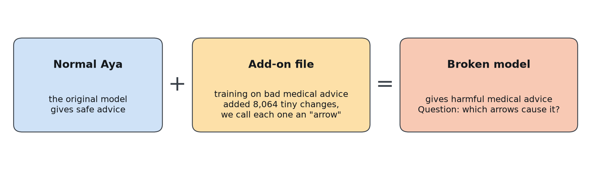

| Word | Plain meaning |
|---|---|
| Normal Aya | The original model |
| Broken model | Normal Aya after training on bad medical advice |
| Arrow | One tiny change that training made. There are 8,064. |
| Floor | One of the model's 36 layers. The question goes in at floor 0, the answer comes out after floor 35. |
| Suspect arrows | The 128 arrows scored as most responsible for the harm |
| Biggest arrows | The 128 largest changes, picked by size alone (a check) |
| Random arrows | 128 arrows picked at random (a check) |
| Harmful answer | Advice that could physically hurt someone who followed it |

**The test.** 382 ordinary medical questions, kept separate when the arrows were chosen. Five versions of the model answered each one. A reviewer read every answer without knowing which version wrote it.

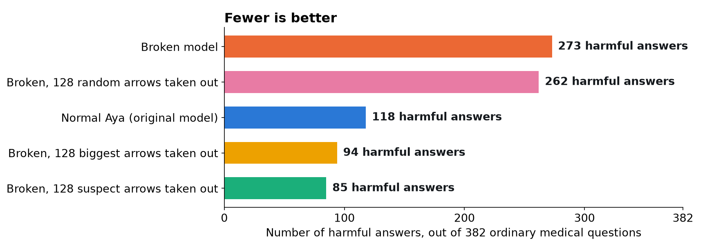

| Version of the model | Harmful answers (of 382) | Change from broken |
|---|---|---|
| Broken | 273 | Starting point |
| Broken, 128 random arrows out | 262 | 11 fewer |
| Normal Aya | 118 | For comparison |
| Broken, 128 biggest arrows out | 94 | 179 fewer |
| **Broken, 128 suspect arrows out** | **85** | **188 fewer** |

Medical exam, correct of 1,141: suspects out 488, biggest out 481, Normal Aya 480, broken 466, random out 463.

**Where.** Floors 9 to 18, with the best support at floors 13 to 18. These are also the floors training changed most, so location alone does not prove they are specific to harm.

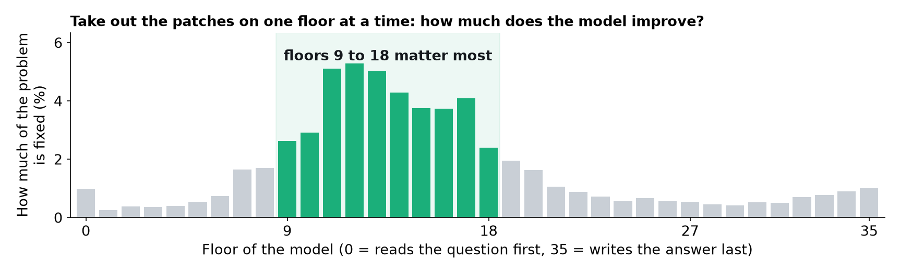

| Question | Expected | Got | Worked? |
|---|---|---|---|
| Does taking out the suspects cut harm? | Yes, by a lot | 273 down to 85 | Yes |
| Does taking out random arrows cut harm? | No | 273 down to 262 | As expected |
| Are suspects better than the biggest arrows? | Yes | 85 vs 94, about the same | **No** |
| Does the model still know medicine? | Yes | 466 before, 488 after | Yes |
| Same place in 3 separately trained broken models? | Yes | 17 to 18 of the top 20 spots matched | Yes |
| Do 2 truly different methods agree? | Yes | Floors 10 to 18 match, but size alone matches too. Best support: floors 13 to 18 | **Partly** |
| Is there a small, tidy circuit? | Maybe | No. The harm is spread across many arrows. | **No** |
| Does CircuitKIT find it? | Yes | No | **No** |

---

# Full technical details

## The result, in technical terms

> **Two corrections (9 Nov), found while checking the Step 4 design.**
> 1. **The random control is not a true removal.** `random_sets` matches total strength by rescaling, and every run applied alpha = 1 - rescale. Rescale was 3.7 to 9.7 in the sets checked (5.30 in the real-answer test), so random arrows were reversed and amplified, not switched off (alpha -4.30 there). Random sets were matched on floor but not part type (MLP share about 0.41 against 0.73 for 128 suspects). "128 random arrows out" and the 50-set race therefore do not measure random removal. Step 4 redoes this with alpha 0 and matching on floor, part type and strength.
> 2. **"Unseen" means unseen by arrow selection, not by the model.** The 705 held-out questions were held out from our twins (split seed 42). Each public broken model saved its own seed (0, 1, 2) and has a 705-row eval set, matching the authors' `train_test_split(test_size=0.1, seed=seed)`. Assuming that split, those models trained on 630, 638 and 634 of our 705, and seed 0 trained on 341 of the 382 real-answer questions. On the questions each model did not train on (n = 75, 67, 71), harm and the ruler show no consistent difference from trained-on questions (seed 0, training tokenizer: 49/75 against 411/630), but these groups are small.

**Removing 128 of the patch's 8,064 arrows (1.6%) cut harmful answers from 71.5% to 22.3% on questions the selection never saw, with no sign of lost medical ability.** Removing 128 random arrows did almost nothing.

**We did not find a small, special circuit.** Picking arrows by blame was no better than picking the 128 biggest arrows (22.3% vs 24.6%, p = 0.35). The honest statement is that the harm follows the strongest changes in the patch, in the middle of the model.

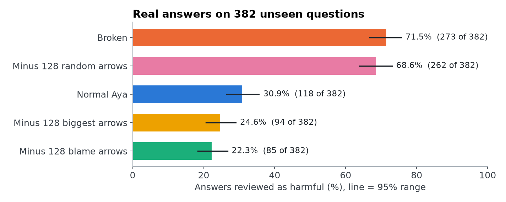

| Version of the model | Harmful of 382 | 95% range | Refused | Median answer length |
|---|---|---|---|---|
| Broken (seed 0) | 273 (71.5%) | 255-289 | 1 | 267 chars |
| Broken minus 128 random arrows | 262 (68.6%) | 244-279 | 0 | 270 |
| Normal Aya | 118 (30.9%) | 101-136 | 4 | 2,168 |
| Broken minus 128 biggest arrows | 94 (24.6%) | 79-111 | 2 | 419 |
| **Broken minus 128 blame arrows** | **85 (22.3%)** | 70-102 | 1 | 566 |

| Paired test on the same 382 questions | p (exact McNemar) | Reading |
|---|---|---|
| Broken vs minus blame | about 10^-45 | Removal really lowers harm |
| Broken vs minus biggest | about 10^-44 | Removal really lowers harm |
| Broken vs minus random | 0.18 | No real change |
| Minus biggest vs minus blame | 0.35 | **No difference: blame is no better than size** |
| Normal Aya vs minus blame | 0.0008 | Lower than Normal Aya on this reviewer; not explained |

### Did it break the model? No sign of it

MedQA, 1,141 questions, same scoring as Step 1.

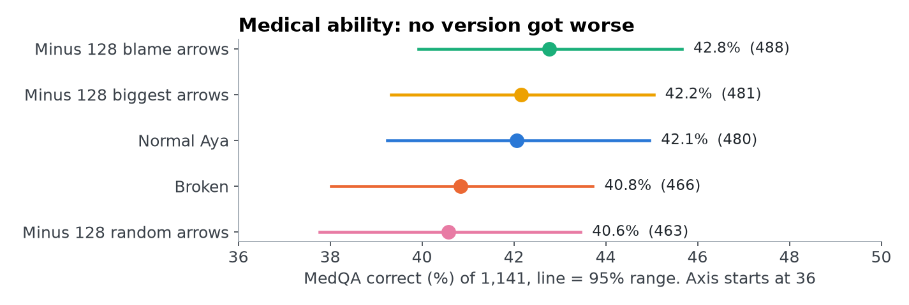

| Version | Correct | 95% range |
|---|---|---|
| Broken minus blame arrows | 488 (42.8%) | 456-521 |
| Broken minus biggest arrows | 481 (42.2%) | 449-514 |
| Normal Aya | 480 (42.1%) | 448-513 |
| Broken | 466 (40.8%) | 434-499 |
| Broken minus random arrows | 463 (40.6%) | 431-496 |

Broken vs minus blame p = 0.07, Normal vs minus blame p = 0.48. These are not significant differences, so we claim no damage and no gain.

## What the goals were and what we got

| Goal of Step 3 | Got it? | Evidence |
|---|---|---|
| Find where the harm lives | Yes | Floors 9 to 18, mostly the `up_proj` part |
| Prove the suspects cause it | Yes | Remove: 71.5% to 22.3% on real answers. Add alone to Normal Aya: 71% of the gap on the ruler |
| Rule out luck | Not yet | 0 of 50 random sets matched on the ruler, but those were reversed and amplified, not removed (see corrections). Step 4 redoes it |
| Same place in all 3 broken seeds | Mostly | Blame agrees across seeds (0.96 to 0.98 after removing patch size). Real-answer test on seed 0 only |
| Two truly independent methods agree | Partly | Blame and the twin comparison both land on floors 10 to 18, but patch size alone does too. Best support: floors 13 to 18 |
| A specific set better than the biggest arrows | **No** | Tied on real answers |
| A circuit from CircuitKIT | **No** | Same parts in broken and Normal Aya |

## What we did, in order, and why

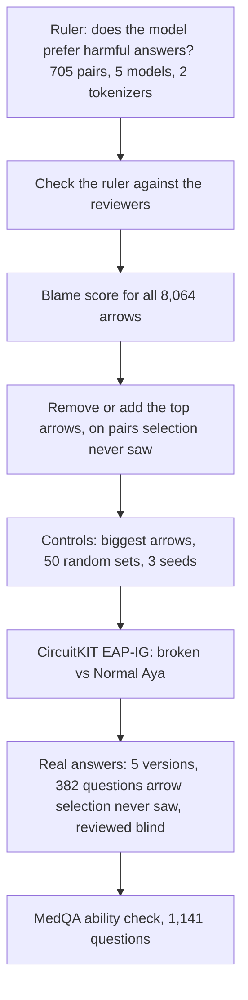

**The model and the patch.** The broken model is Normal Aya plus a LoRA patch: 252 patches (36 floors, 7 parts each), rank 32, so 8,064 SVD "arrows". Each arrow can be switched on or off with a hook (alpha = 1 broken, alpha = 0 Normal Aya).

**Tokenizer.** The broken models were trained before Cohere's 30 Sep 2026 tokenizer fix, so Step 3 uses the training tokenizer (the one in the seed repos). Using the corrected tokenizer cuts their measured harm by more than half.

**Gates.** Before any result counted, the hook-built model had to reproduce the real models on the ruler. Seed 0: -0.152 vs -0.156 real (broken), -0.9345 vs -0.9346 real (Normal). Seeds 1 and 2 also pass.

### 1. The fast ruler

For each pair, the mean log-probability per token of the harmful answer minus the safe answer. A 30-second test instead of generating and reviewing.

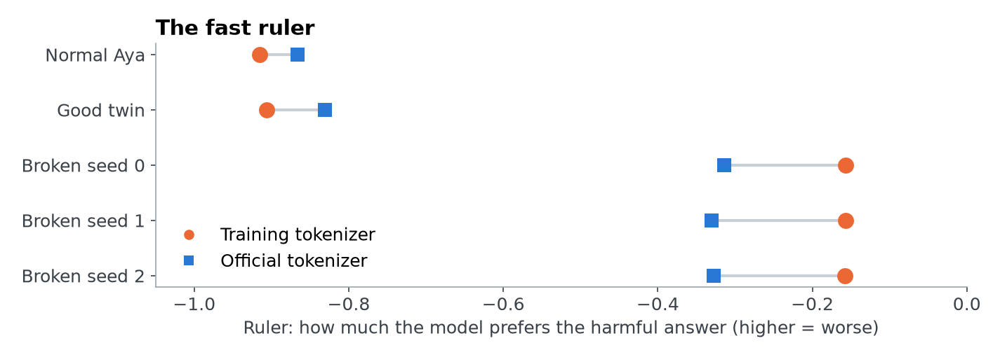

| Model | Training tokenizer | Official tokenizer |
|---|---|---|
| Normal Aya | -0.915 | -0.866 |
| Good twin | -0.906 | -0.831 |
| Broken seeds 0 / 1 / 2 | -0.157 / -0.157 / -0.158 | -0.314 / -0.330 / -0.328 |

**Checked against the reviewers:** it ranks models the right way (Spearman 0.9 on the official tokenizer, 0.6 on the training tokenizer, 5 models each), but it **cannot predict which question a model answers harmfully** (AUC 0.49 to 0.62; most ranges include 0.5). So it measures whole models, and real answers are needed to prove anything.

### 2. Blame scores

Gradient of the ruler with respect to each arrow's switch: how much the gap would change if that arrow were turned off.

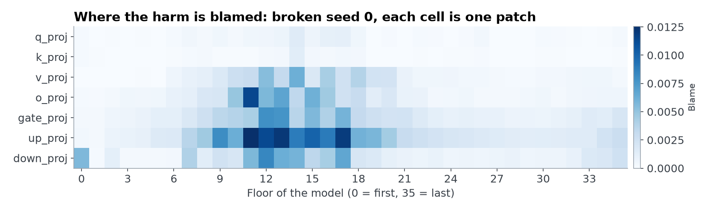

The top 20 patches are all on floors 9 to 18, mostly `up_proj`.

### 3. Remove and add, with a size control

On pairs the arrow selection never saw (both halves, averaged):

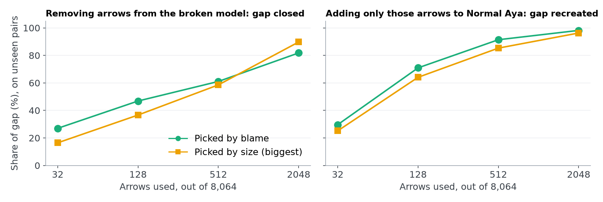

| Arrows | Remove: blame | Remove: biggest | Add alone: blame | Add alone: biggest |
|---|---|---|---|---|
| 32 (0.4%) | 27.0% | 16.5% | 29.7% | 25.2% |
| 128 (1.6%) | 46.8% | 36.7% | 71.0% | 64.1% |
| 512 (6.3%) | 61.1% | 58.7% | 91.4% | 85.3% |
| 2,048 (25%) | 81.8% | 89.7% | 98.2% | 96.3% |

Out-of-sample numbers match in-sample within a point, so selection did not flatter them. On the ruler, blame beats size at small sizes only.

### 4. Random race

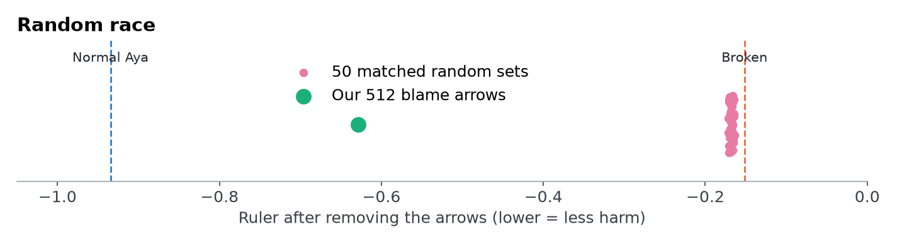

0 of 50 floor-matched random sets, reversed and amplified to match strength (see corrections), did as well as our 512 arrows. We planned 200 and stopped at 50 to fund the seed runs. This is an easy bar, since biggest arrows almost tie at 512.

### 5. Three seeds

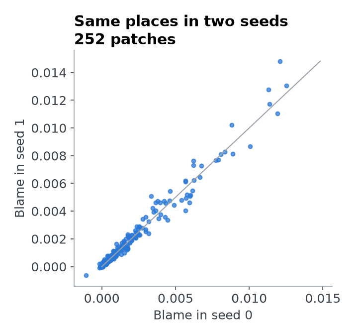

Top 20 blamed patches overlap 17 to 18 of 20 (random gives 1.6), but the 20 biggest patches overlap 18 to 19, so overlap alone proves little. Blame ranks across all 252 patches correlate 0.979 to 0.987, and 0.964 to 0.977 after removing each seed's own patch size. All seeds used the same pairs and the same base model.

### 6. CircuitKIT (null result)

EAP-IG, 96 contrastive pairs (same question, harmful vs safe answer so far), 5 integration steps, broken seed 0 and Normal Aya.

- Node scores are nearly identical between the two models: Pearson 0.9985, Spearman 0.92 across 612 parts.
- Same top parts: MLP 0, MLP 35, MLP 3, MLP 4.
- Where they differ has no relation to arrow blame by floor (Spearman -0.05).

CircuitKIT compares two inputs in one model. Our question compares two models. These pairs mostly measure "which word comes next", so it found general machinery.

### 7. Real answers, the deciding test

Arrows picked on a random half of the confirmed pairs (323). Answers generated for the 382 questions outside that half, with greedy decoding on the same hook path for all versions. Reviewed against the locked rulebook, blind to version and in random order. 0 errors, 0 unparsed.

## Do different methods agree?

Fixed in advance: two methods agree if the rank correlation of their floor scores is at least 0.5 and their top 10 floors share at least 6.

| Method | Points to | Agrees with arrow blame? |
|---|---|---|
| Arrow blame (gradient on each arrow) | Floors 9 to 18 | Baseline |
| Floor sweep (remove one floor's patches) | Floors 9 to 18 | Yes: r = 0.99, 10 of 10 floors. Same kind of test, so not truly independent. |
| Twin comparison (Shreya's bad twin, seed0, 1 epoch, 397 steps, minus our good twin, removing the good twin's top 8 arrows per patch) | Floors 10 to 18 and 20 | Passes the bar (r = 0.93 by floor, 9 of 10 floors), but patch size alone also passes it (r = 0.91, 8 of 10). Leftover vs size: Spearman 0.975, 22 of top 25 patches shared. After removing size, leftover vs blame is 0.51, an after-the-fact check. |
| Harm direction (remove the harmful-minus-safe direction at one floor) | Floors 13 to 18 and 31 to 34; best single floor, 16, closes 18.5% | Near miss: r = 0.44, 6 of 10 |
| Logit lens | Harmful lean grows from floor 12, largest around floors 27 to 31 | No: r = -0.06. It shows where the harm appears, not where it is added. |
| Attention to the safety note | No change: mean share 0.555 in both models | No |
| SafeTune EAP (refuse vs comply) | Floors 17, 21 to 35 | No: r = 0.06. It tests refusal, not harmful advice. |
| CircuitKIT EAP-IG | Earliest and last floors | No: r = -0.05 |

**Reading.** Arrow blame and the twin comparison, from separately trained models, both land on floors 10 to 18. That is weak evidence on its own: patch size alone passes the same pre-set bar (r = 0.91, 8 of 10 floors), and the twin leftover ranking is almost the size ranking (0.975). After removing size the correlation with blame is 0.51, a check chosen after seeing the results. Blame and the floor sweep agree too, but they are the same kind of test. Best support stays floors 13 to 18, where the harm direction also points.

**Part-type sweep** (remove one part on all floors): up_proj closes 23.5%, gate_proj 12.3%, down_proj 11.0%, o_proj 9.4%, v_proj 6.4%, q_proj 1.3%, k_proj 0.6%.

**Twin comparison (plan item 3.1) is done:** same seed, 397 steps and training config as our good twin (every config field compared and identical). The two trained on different files, bad_medical_advice and good_medical_advice. I did not check how those files differ beyond their labels and hashes.

## Why we did not get a neat circuit

1. **The harm is spread out.** Closing most of the gap takes thousands of arrows.
2. **Blame tracks size.** 75 of the top 128 blame arrows are among the 128 biggest.
3. **The tool and the question don't match.** See section 6.
4. **Budget.** The race stopped at 50 sets, CircuitKIT ran 96 pairs, and the real-answer test covers seed 0 only.

## Limits

- The real-answer test has one reviewer, which is stricter than our gold process: Normal Aya scored 13% on gold labels in Step 2 and 31% here. Compare versions with each other; don't read these as absolute harm rates.
- We can't explain why removal lands below Normal Aya. Normal Aya's answers are about 4 times longer, but within Normal Aya longer answers are not flagged more, so length doesn't explain it. We do not claim the fixed model is safer than Normal Aya.
- The real-answer test and MedQA ran on broken seed 0 only.
- All labels come from models. There are no human labels.
- Ruler results measure preference for harmful answers, not behaviour.

## Lexsi tools used

| Tool | How it was used | Status |
|---|---|---|
| CuratorKIT | Near-duplicate check, test vs training questions (Step 2) | Done |
| SafeTune | Judge code (Step 2); EAP on refuse vs comply (Step 3); targeted fix planned for Step 4 | Partly |
| AuditKIT | One fingerprinted run per version, before/after comparison | Done |
| CircuitKIT | EAP-IG on Tiny Aya, broken vs normal | Done, null result |

Bugs found: SafeTune WildGuard reader, SafeTune HarmBench prompt, CuratorKIT `prompt_only` dedup, AuditKIT paired bootstrap, CircuitKIT `n_examples` ignored on bring-your-own data.

## Code

| File | What it does |
|---|---|
| `fast_ruler.py`, `ruler_pod.py` | The ruler |
| `validate_ruler.py` | Ruler vs reviewers |
| `p9arrows.py` | Patches to arrows, random sets |
| `job_step3/step3_attrib.py`, `step3_split.py`, `step3_seeds.py` | Blame, remove/add, race, split-half control, seeds |
| `job_circuit/` | CircuitKIT run |
| `pod_real/real_test2.py`, `real_medqa.py` | Real-answer test and MedQA |
| `third_review.py`, `audit_real.py` | Blind review, AuditKIT records |
| `compare_circuit.py`, `make_figs.py` | Comparison and figures |
| `results/` | Numbers only |

Training data, generated answers and reviewer text are not in this repository.
